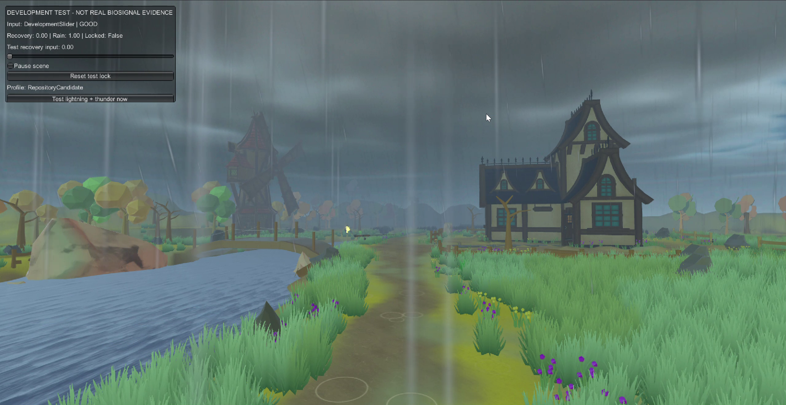
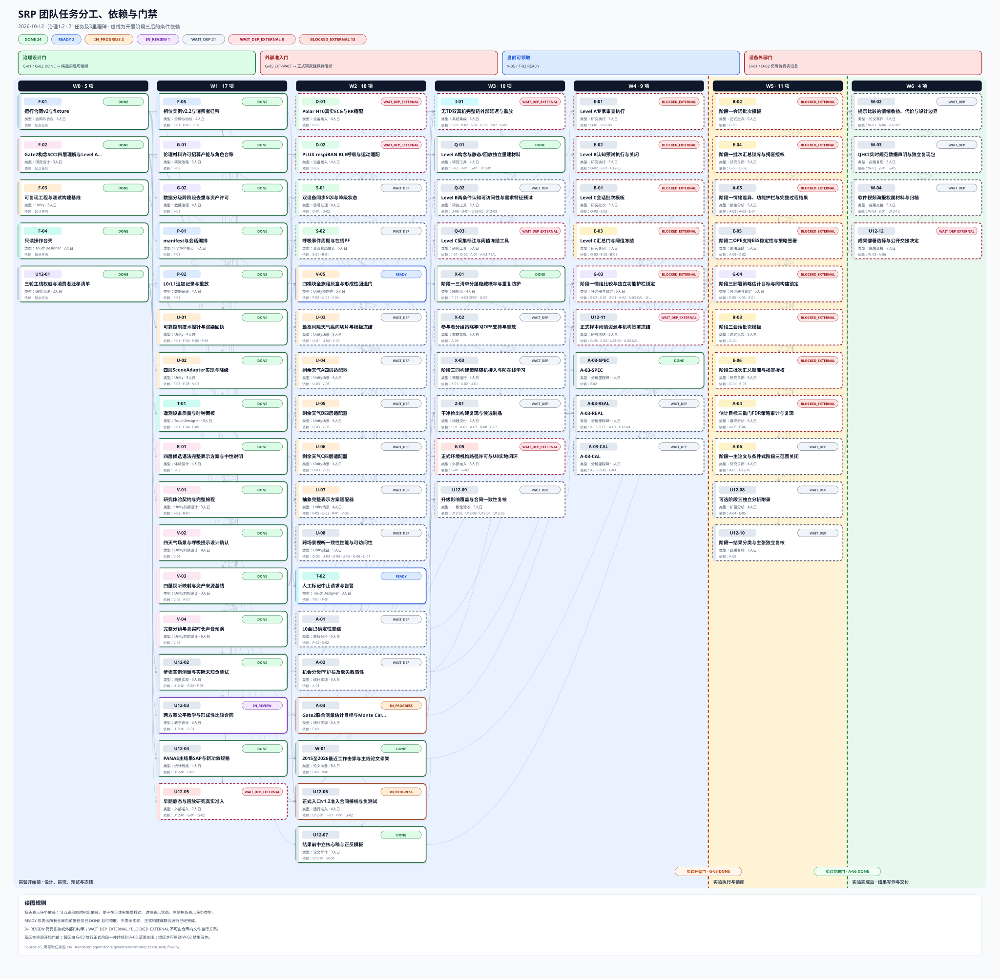

# SRP · 多模态呼吸交互与情绪调节教育

完整规范化项目版本：[d2245d4d](https://github.com/JunyeFu/Emotional-Healing-System/tree/d2245d4dee7916f898be2ff872a2062b6617ee92)，2026-10-13发布。main同步展示与开发导航，运行实现保留在工作分支。

把呼吸练习融入天气场景，用视听反馈连接身体节奏与交互体验。面向普通学习间隙的自愿练习者，也面向研究、设计与开发协作者。

**当前阶段：设计与工程候选开发。** 已有成员场景演示、Python会话与记录底座、任务审阅材料；完整真机链与正式参与者结果尚未交付。



上图来自2026-10-08成员录屏，保留开发面板，只展示可见外观。更多画面、TD设计稿及各自证据范围见[成果展示](human/deliverables/README.md)。

## 从这里进入

| 你想做什么 | 入口 |
|---|---|
| 认识项目与研究问题 | [项目概览](human/project/README.md) |
| 看已有成果与演示 | [成果目录](human/deliverables/README.md) · [对外介绍](human/project/project-introduction.md) |
| 运行验证、继续开发 | [开发上手](human/developers/README.md) · [模块地图](human/project/PROJECT_MODULES.md) |
| 领取任务或审阅交付 | [任务导航](human/tasks/README.md) |
| 维护权威材料与生成工具 | [Agent执行层](https://github.com/JunyeFu/Emotional-Healing-System/blob/d2245d4dee7916f898be2ff872a2062b6617ee92/agent/README.md) |

## 两种完整体验方案

- **A：固定引导。** 呼吸引导圈和预设场景变化共同呈现练习节奏。
- **B：场景原生受限适应。** 根据实际呼吸与场景状态调整实际引导，再趋向共同理想目标。

两组共享理想目标I；实际引导G与实际呼吸X独立记录。研究关注情绪收益、执行表现与调整成本，不把视觉效果或软件测试当作参与者效果。[设计地基](https://github.com/JunyeFu/Emotional-Healing-System/blob/d2245d4dee7916f898be2ff872a2062b6617ee92/agent/design/design-foundation-20261008/README.md) · [实验设计论证](https://github.com/JunyeFu/Emotional-Healing-System/blob/d2245d4dee7916f898be2ff872a2062b6617ee92/agent/design/研究主旨与实验设计论证_当前.md)

## 系统如何协作

```text
可穿戴设备 → Python采集、交互状态估计、会话编排与记录 → Unity参与者体验
                                       └──────────────→ TD操作台与监控
原始记录、问卷与回执 → 离线重建与分析 → 图表和论文材料
```

Python掌握流程与时钟；Unity独立完成画面，TD不直接控制研究流程。[运行入口](https://github.com/JunyeFu/Emotional-Healing-System/blob/d2245d4dee7916f898be2ff872a2062b6617ee92/agent/runtime/README.md)区分可验证的底座与尚未接通的正式链。

## 团队进展

<!-- TEAM_PROGRESS_START -->
## 团队任务进度

治理v1.2：71项任务（68固定+3模板）；DONE=24项（含18项原签收）；IN_PROGRESS=A-03/U12-06；IN_REVIEW=U12-03；A-03-SPEC为DONE；READY=V-05/T-02；真实准入与研究数值仍未冻结

[](human/assets/readme/team-task-progress.svg)

点击图可打开原始SVG放大查看。图与摘要由同一任务注册表生成。
<!-- TEAM_PROGRESS_END -->

原签收只覆盖原范围；目录整理不改变业务状态。当前任务与冻结要求以[任务导航](human/tasks/README.md)中的治理权威为准。

## 目录与协作

```text
human/       项目介绍、成果、开发指南、任务审阅
agent/       源码、合同、设计、治理、验证、任务执行
AGENTS.md    项目执行约束
CONTRIBUTING.md  协作入口
```

[目录与命名规范](human/project/repository-layout.md) · [目录改造任务书](human/project/repository-restructure-taskbook-20261013.md) · [协作指南](CONTRIBUTING.md)

本地唯一入口为 `D:\Agent\srp`。GitHub默认首页展示项目；完整实现版本见[工作分支](https://github.com/JunyeFu/Emotional-Healing-System/tree/codex/td-workbench-readability)。正式参数、设备联调与参与者研究仍需各自验收，不提供“一键正式实验”承诺。
