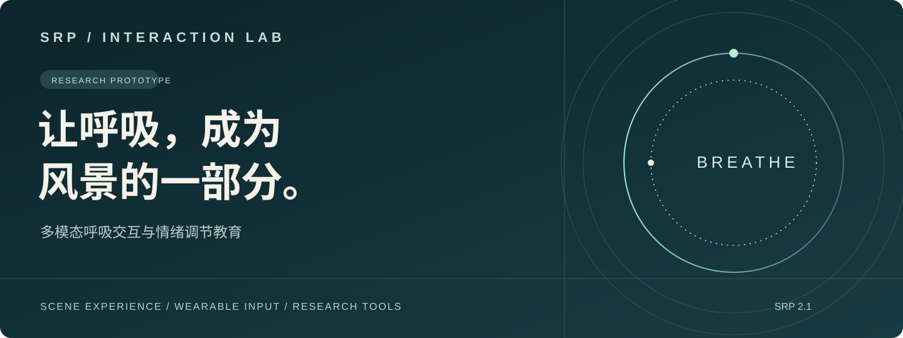
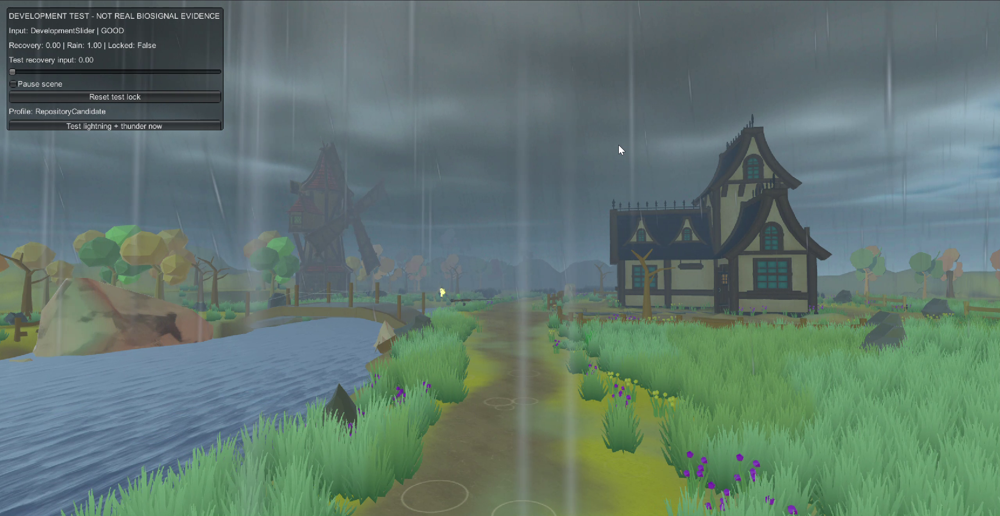
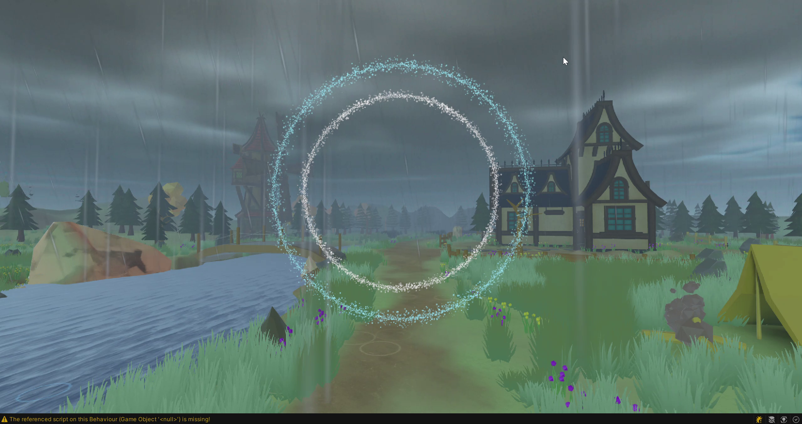
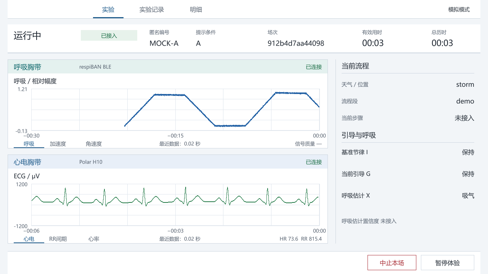
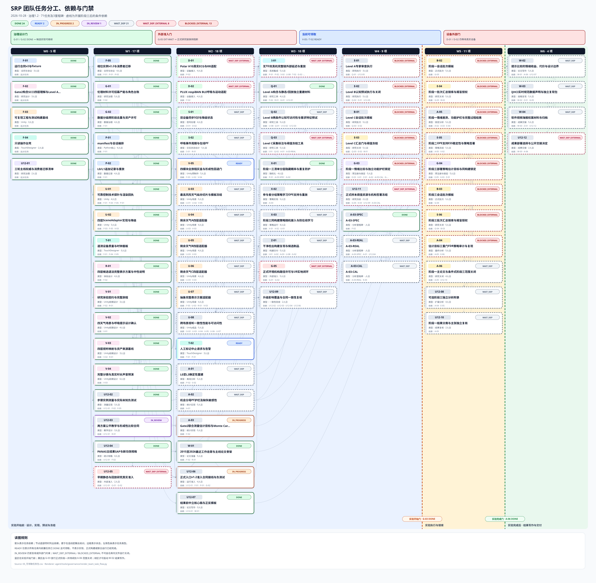

<p align="center">
  
</p>

<h1 align="center">SRP · 多模态呼吸交互</h1>
<p align="center">把身体节奏融入天气场景，让短时呼吸练习拥有可感知的视听反馈。</p>
<p align="center">
  <a href="#体验画廊">体验画廊</a> ·
  <a href="#当前进展">当前进展</a> ·
  <a href="human/developers/README.md">开发上手</a> ·
  <a href="human/tasks/README.md">参与协作</a>
</p>

<p align="center"><strong>场景体验 × 可穿戴输入 × 研究工具</strong><br>当前阶段：工程候选与合成验证 · 内容更新：2026-11-01</p>

---

## 体验画廊

### 01 / 在天气中，看见节奏

溪边木屋、雨幕与水面波纹构成固定镜头下的练习空间。视觉提示从环境中自然出现，四种天气各围绕一个核心机制展开。



<sub>Storm · 2026-10-08 成员开发录屏原帧，保留原测试面板。</sub>

### 02 / 用粒子，呈现呼吸引导

屏幕空间粒子双环提供直观的节奏参照。项目比较固定引导与场景原生受限适应，关注体验、执行表现和调整成本。



<sub>双环外观演示 · 原帧保留脚本缺失警告；场景演示不代表完整系统联调通过。[查看素材来源](human/assets/previews/2026-10-08/member-storm-particle-rings/README.md)</sub>

### 03 / 一张工作台，掌握练习流程

TD 手动工作台将设备曲线、当前流程、暂停与后测组织在同一个操作界面中。准备、开始和结束由操作员明确控制。



<sub>TouchDesigner 原生界面 · 2026-10-15 手动模拟验收。设备、Unity端与问卷回执为模拟，会话与存储使用实际 P-01/P-02。[查看71个检查点及结果](agent/tasks/T-01/evidence/manual-20261015-105659/README.md)</sub>

[浏览全部成果与证据 →](human/deliverables/README.md)

## 从练习体验，到可分析的记录

| 参与者体验 | 操作与采集 | 离线分析 |
|---|---|---|
| Unity 天气场景与粒子引导 | Python 会话、时钟、设备接入与记录；TD 操作台 | 六类输入只读重建、统计、图表与报告 |
| 固定镜头，让提示融入环境 | 保留准备、暂停、退出与封存过程 | 区分情绪收益、执行表现与调整成本 |
| [体验与场景设计](agent/design/weather/四种天气设计.md) | [当前运行入口](agent/runtime/README.md) | [分析软件与数据格式](agent/modules/srp_analysis/README.md) |

### 两种完整体验，共同的练习目标

| A · 固定引导 | B · 场景原生受限适应 |
|---|---|
| 呼吸引导圈与预设场景变化共同呈现固定练习节奏。 | 根据实际呼吸与场景状态，在限定范围内调整引导，再趋向共同目标。 |

两组共享理想目标 **I**，实际引导 **G** 与实际呼吸 **X** 独立记录。研究要回答的是：体验与情绪收益如何变化，执行表现和调整成本又如何变化？

[阅读项目概览](human/project/README.md) · [设计地基与实验候选](agent/design/design-foundation-20261008/README.md)

## 当前进展

| 模块 | 已有交付 | 下一步 |
|---|---|---|
| Unity 场景 | Storm 与纯粒子双环成员演示 | 目标版本迁移、四天气整合与完整旅程验收 |
| TD 工作台 | 手动模拟工作台与71点原生检查记录；BigRun预览工程 | 正式请求接口及真实设备联合验证 |
| BigRun 采集 | BLE 接入、原始通道记录、P-02归档和连接阶段显示 | 持续采集稳定性、时钟、单位与独立呼吸参考验证 |
| 离线分析 | `demo / prepare / analyze`、统计与报告；合成演练已完成 | 正式输入、统计规格冻结与独立复算 |
| 团队协作 | 71项任务体系、独立领取包与进度图 | 按当前范围逐项验收 |

完整真机链、正式参数与参与者研究结果尚未交付。软件与合成演练的完成范围见[分析关闭记录](agent/work/2026-10-19_analysis-closure.md)；设备现状见[BigRun接入说明](agent/modules/acquisition/bigrun/README.md)。

## 开始探索

**看作品** → [成果展示](human/deliverables/README.md) · [项目介绍](human/project/project-introduction.md)<br>
**运行代码** → [开发上手](human/developers/README.md) · [运行入口](agent/runtime/README.md)<br>
**加入协作** → [任务导航](human/tasks/README.md) · [贡献指南](CONTRIBUTING.md)

取得源码与大文件：

```powershell
git clone --branch main https://github.com/JunyeFu/Emotional-Healing-System.git srp
Set-Location srp
git lfs install --local
git lfs pull
```

完成[分析环境准备](agent/modules/srp_analysis/README.md#直接运行)后，可先运行不需要设备的合成演练：

```powershell
agent/runtime/srp-analysis.cmd demo --out agent/local/artifacts/my-analysis-demo
```

输出包含派生表、统计图与报告，数据均为合成。Unity 团队目标为 **2022.3.62f3**，共享工程版本迁移尚未验收；TD 为 **2025.32820**。具体环境与版本差异见[开发指南](human/developers/README.md)。

<details>
<summary><strong>团队任务进度 · 展开查看注册表生成图</strong></summary>

<!-- TEAM_PROGRESS_START -->
## 团队任务进度

治理v1.2：71项任务（68固定+3模板）；DONE=24项（含18项原签收）；IN_PROGRESS=A-03/U12-06；IN_REVIEW=U12-03；A-03-SPEC为DONE；READY=V-05/T-02；真实准入与研究数值仍未冻结

[](human/assets/readme/team-task-progress.svg)

点击图可打开原始SVG放大查看。图与摘要由同一任务注册表生成。
<!-- TEAM_PROGRESS_END -->

原签收覆盖原范围，新增范围按当前任务材料验收。[任务权威与领取入口](human/tasks/README.md)

</details>

## 仓库导航

```text
human/                   面向读者：项目、成果、开发指南、任务导航
agent/modules/           源码：采集、会话、存储、分析、Unity、TD
agent/runtime/           当前运行入口
agent/design/            体验、视听映射与研究设计
agent/tasks/             任务输入、实现、交付与验证
agent/governance/        任务注册、领取与签收
agent/archive/           历史材料
```

本地环境与工作产物归入被忽略的 `agent/local/`，研究原始数据不随源码公开。当前与历史入口按[目录规范](human/project/repository-layout.md)区分；源码职责见[模块地图](human/project/PROJECT_MODULES.md)。

---

<p align="center"><strong>让练习融入环境，让每一步都有清楚的记录。</strong><br>SRP · 多模态交互与情绪调节教育</p>
