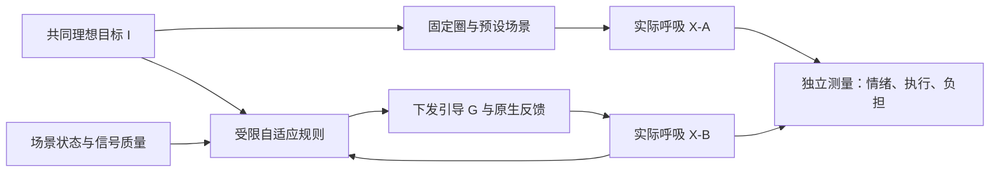

# 写作前论证：固定引导与原生自适应完整方案

用户已明确：只有原生组根据实际数据调节；理想节奏与固定组一致；结合场景状态和被试状态，允许受限调整引导时序再回归理想。该决定覆盖上一版“同算法、同反馈、只改表示”的前提。

| 要先想清楚的事 | 本轮结论 | 理由及可反驳条件 |
|---|---|---|
| 研究对象 | 固定开环与原生闭环自适应两个完整方案 | 随机比较识别整包效应；两臂无法拆出原生形式、真实反馈、时序适应的单独贡献 |
| 理想与实际提示 | 理想I固定，实际下发G可受限偏离；实际呼吸X独立测量 | 若修改I来迎合X，便失去共同练习目标；若只看X对G的匹配，会奖励移动目标 |
| 参照组 | 固定圈与预设场景都不读取本人的生理数据；仍佩戴同设备用于盲态测量 | 采集不等于反馈。固定组不呈现Actual内圈、不显示伪成功，也不冒充安慰剂反馈 |
| 自适应位置 | 首版在合法周期边界有限调整下一周期吸/呼时长及场景反馈；必要缓冲明确自然呼吸 | 不在吸后停留中无限等待，不跳过必需步骤，不因画面好看延长模块 |
| 主要效益 | 推荐保留前测校正PANAS-NA后测为主要候选，执行/负担/舒适独立报告 | 校园短时情绪调节是产品用途；量表地板、版本和时间指令须前置验证，正式研究前冻结 |
| 理解测量 | 降为方案适配的形成性检查；共同目标题才可有限跨组比较 | 固定组没有Actual信息，用同一Actual考试排名属于结构性不公平 |
| 新颖性 | 自适应、自然反馈、固定与反馈比较均已有先例 | ViBreathe 2021、Gummidela 2021、Yu 2026覆盖直接方向；候选增量收敛到多步骤原生闭环及目标偏离代价的实证边界 |
| 科研与产品 | 先回答整包是否值得采用，再研究独立机制 | 因子/消融需要额外条件、样本和问题；不把两臂结果包装成机制因果证据 |

选择理由：纯表示比较与用户意图不符；首轮做三因素全因子会扩大资源；当前选两臂整包研究，明确其解释边界。算法参数、边界和场景映射均在结果前确定，不以100+人数或预期效果倒填。

最先需要解决的设计事实：场景状态只是模块/阶段/过渡/可用反馈空间；被试状态先用可可靠测得的呼吸步骤、节奏、误差、质量及主动停止。H10辅助过程指标不直接充当情绪判断或快速调节依据。正式研究条件改变需另修现行v1.2；本轮只写设计，不改Target API、注册状态或领取快照。
