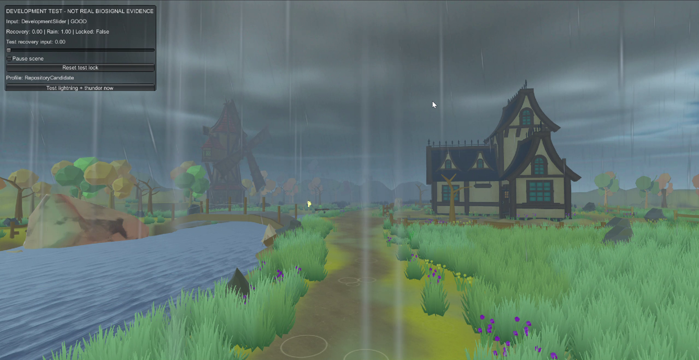
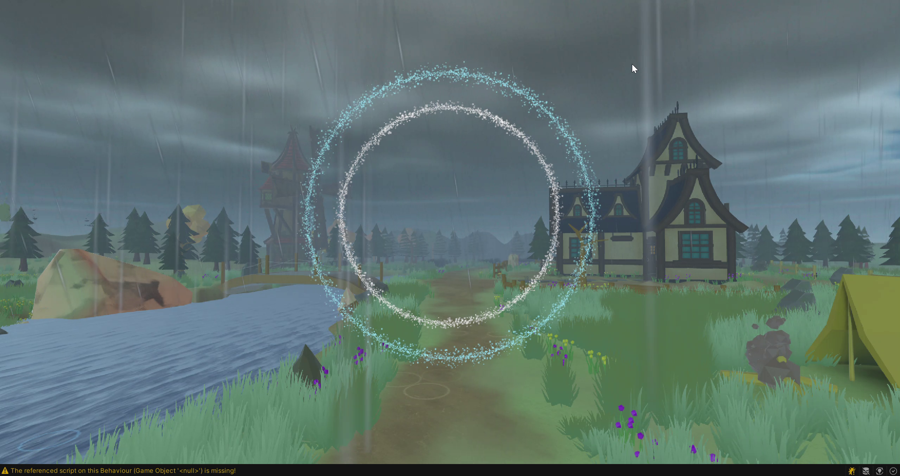
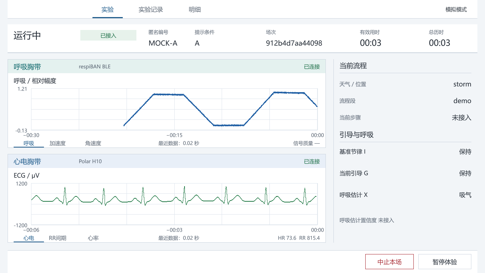

# 成果展示

## 成员场景演示

2026-10-08成员开发录屏原帧，保留测试面板。[原帧目录](../assets/previews/2026-10-08/member-storm-particle-rings/README.md)记录来源与时间。

双环外观参考，原视频包含脚本缺失警告；单帧不证明接口、性能或正式构建通过。

## TD 手动工作台

2026-10-15原生模拟验收截图，设备、Unity端与问卷回执为模拟。工作台覆盖手动准备、开始、暂停、中止、后测与历史记录；[71点检查记录](../../agent/tasks/T-01/evidence/manual-20261015-105659/README.md)。[运行入口](../../agent/runtime/README.md)分别说明手动Mock与BigRun预览。

## 可打开的材料

| 成果 | 类型与版本 | 入口 | 证明范围 |
|---|---|---|---|
| Storm与粒子双环 | 成员录屏，2026-10-08 | [画面与交接](../../agent/work/2026-10-08_李民约_Storm与粒子双环进展.md) | 视频可见外观，非完整联调 |
| TD十二页操作台 | diagrams.net设计，2026-10-12 | [设计记录](../../agent/work/2026-10-12_TD矢量页面设计.md) | 布局、对齐与小字清理，非TD实现 |
| TD手动工作台 | 原生TOE与71点模拟检查，2026-10-15 | [操作说明](../../agent/modules/touchdesigner/t01_telemetry_panel/README.md) | 模拟输入下的原生操作与P-01/P-02，不代表真实联合链 |
| BigRun采集候选 | BLE驱动、P-02记录与TD预览 | [采集手册](../../agent/modules/acquisition/bigrun/README.md) | 软件接入；真实稳定性和呼吸参考待验 |
| 离线分析软件 | 六类输入、统计、图表与报告 | [分析手册](../../agent/modules/srp_analysis/README.md) · [演练记录](../../agent/work/2026-10-19_analysis-closure.md) | 合成演练与软件候选，非参与者结果 |
| A/B完整体验设计 | 设计地基，2026-10-08 | [设计材料](../../agent/design/design-foundation-20261008/README.md) | 设计候选，最新07以源稿为准 |
| Python会话与记录 | 当前源码与测试 | [开发上手](../developers/README.md) | 软件状态、记录与重放合同 |
| 71包任务交付 | 当前逐包审阅 | [任务索引](../tasks/README.md) · [串联PDF](../project-review.pdf) | 交付与实际缺口 |
| 团队进度 | 注册表生成图 | [状态图](../assets/readme/team-task-progress.svg) | 已登记业务状态 |

[对外介绍](../project/project-introduction.md)用于展示，[项目概览](../project/README.md)用于进一步审阅。

## 交付与历史入口

当前[固定任务概要PDF](pdf/02_固定任务概要.pdf)由[Agent交付源码](../../agent/delivery/briefs/README.md)构建，状态与任务注册表核对。逐包证据以LaTeX维护并导出PDF；本文档、简报及逐包PDF是项目说明，不是参与者研究结果或正式产品验收。

团队图直接打开：[任务状态与门禁](../assets/diagrams/SRP_任务状态与门禁解释清单_v1.0.svg)、[任务关联与门禁](../assets/diagrams/SRP_项目任务关联与门禁流程_v1.0.svg)。同目录PNG用于需要位图的查看方式，根README继续显示紧凑进度SVG。

[旧简报](archive/README.md)已明确归档；不要从历史计数、旧护罩/路径机制或旧联合门推断当前设计。当前背景见[项目概览](../project/README.md)，实现与验证见[Agent执行层](../../agent/README.md)。

当前研究与任务设计以[新基线任务包迁移](../../agent/work/2026-10-08_新基线任务包迁移.md)为准。现有视觉资产保留[2026-10-08成员实现标准](../../agent/design/weather/2026-10-08_Storm与纯粒子双环实施标准.md)及[原视频截图](../assets/previews/2026-10-08/member-storm-particle-rings/README.md)；这些素材不证明新增原生自适应已运行。2026-10-06双环说明包和ZIP保留原版本，不作为新版纯粒子参数冻结证据。
